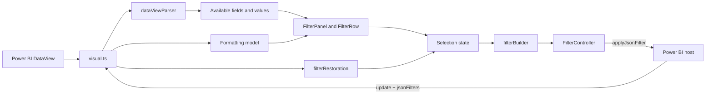

# Universal Filter

Universal Filter is a Power BI custom visual that lets a report author place up to 20 independent field filters in one visual. Each row contains a field selector and a value selector, and each row can be formatted and configured independently.

This repository is a behavior-preserving refactor of the original visual. It keeps the original visual GUID, API version, capabilities, persisted formatting property names, icon, and CSS while separating Power BI integration, data parsing, state management, filtering, formatting, and React presentation into focused modules.

## Project overview

A basic Power BI slicer normally filters one assigned field. Universal Filter is intended for compact filter panels where report users need to choose both the field and its value without adding many separate slicer visuals.

Major capabilities include:

- Up to 20 assigned Power BI fields and 20 visible filter rows.
- Add and remove filter rows without duplicating a selected field.
- Current Dropdown, List Slicer, Button Slicer, and Option Slicer presentations.
- Single-select or multi-select behavior per row.
- Boolean normalization for Boolean, numeric `0/1`, text `"0"/"1"`, and text `"true"/"false"` fields.
- A UI-only **All** option that means “no restriction” and includes blanks.
- Independent filters applied together through the Power BI host.
- Per-filter titles, headings, selector colors, text, borders, padding, selection colors, and container styling.
- Compatibility fallbacks for formatting properties saved by earlier versions.

Typical uses are filter sidebars, exploratory reports, compact dashboards, and reports whose users need to change which columns are filtered.

## Technology stack

| Technology | Purpose | Where it is used |
| --- | --- | --- |
| TypeScript 5.5 | Strict domain types, pure transformations, and SDK integration | All files under `src/` |
| Power BI Visuals API 5.3 | Visual lifecycle, DataViews, host filtering, and formatting model contract | `src/visual.ts`, `src/data/`, `src/filters/` |
| Power BI Formatting Model utilities 6.0.4 | Native Format visual cards, groups, and controls | `src/formatting/settings.ts` |
| React 19 | Declarative UI and local interaction state | `src/components/` |
| CSS and LESS | Existing visual appearance and the Power BI style entry | `src/styles/visual.css`, `style/visual.less` |
| ESLint | Power BI-specific and general static checks | `eslint.config.mjs` |
| Power BI visuals tools 7.2.1 | Development server and `.pbiviz` packaging | `npm start`, `npm run build` |

`d3` and its types are retained from the reference project for dependency compatibility, although the current renderer does not call D3 directly.

## Prerequisites

Install:

1. Node.js and npm. This project was validated with Node.js `v24.22.1`; use a version supported by your installed Power BI visuals tools.
2. [Power BI Desktop](https://powerbi.microsoft.com/desktop/).
3. [Power BI visuals tools](https://learn.microsoft.com/en-us/power-bi/developer/visuals/environment-setup):

   ```powershell
   npm install --global powerbi-visuals-tools@7.2.1
   ```

4. VS Code or another TypeScript-capable editor.
5. A trusted Power BI development certificate when using the live development server. Run `pbiviz --install-cert` if the tooling asks you to create or install one.

Power BI Desktop requires developer mode for file-based custom visuals in each applicable session. In the current file settings, enable **Develop a visual** before importing or testing the package.

## Installation and setup

From this directory:

```powershell
npm ci
npm run typecheck
npm run lint
```

Start the development server:

```powershell
npm start
```

Create the production package:

```powershell
npm run build
```

The package is written to:

```text
dist/MyCustomVisual1234567890.1.0.0.0.pbiviz
```

To test the packaged visual in Power BI Desktop:

1. Open a report and enable **Develop a visual** for the current file/session.
2. In the Visualizations pane, choose **Import a visual from a file**.
3. Select the `.pbiviz` file under `dist/` and accept the warning only if you trust this source.
4. Add **Universal Filter** to the report canvas.
5. Assign columns to `Field 1` through `Field 20` as needed.
6. Use each row’s field selector and value selector, then confirm other visuals respond.
7. Open **Format visual** to inspect the `Filter 1` through `Filter 20` cards.

Microsoft documents the packaging process in [Package a Power BI visual](https://learn.microsoft.com/en-us/power-bi/developer/visuals/package-visual) and file import in [Import Power BI visuals](https://learn.microsoft.com/en-us/power-bi/developer/visuals/import-visual).

## Project structure

```text
universal-filter-refactored/
├── assets/
│   └── icon.png
├── src/
│   ├── components/
│   │   ├── selectors/Selector.tsx
│   │   ├── FilterHeader.tsx
│   │   ├── FilterPanel.tsx
│   │   └── FilterRow.tsx
│   ├── constants/filter.constants.ts
│   ├── data/
│   │   ├── booleanDetection.ts
│   │   ├── dataViewParser.ts
│   │   ├── filterRestoration.ts
│   │   └── valueIdentity.ts
│   ├── filters/
│   │   ├── filterBuilder.ts
│   │   ├── filterController.ts
│   │   └── filterSignature.ts
│   ├── formatting/
│   │   ├── defaults.ts
│   │   ├── legacySettings.ts
│   │   ├── settings.ts
│   │   └── styleResolver.ts
│   ├── state/
│   │   ├── selectionState.ts
│   │   └── valueSelection.ts
│   ├── styles/visual.css
│   ├── types/
│   │   ├── data.types.ts
│   │   ├── filter.types.ts
│   │   ├── formatting.types.ts
│   │   └── styles.d.ts
│   └── visual.ts
├── style/visual.less
├── capabilities.json
├── pbiviz.json
├── package.json
└── tsconfig.json
```

The folders follow the visual’s real execution boundaries. `data/` understands Power BI input, `state/` owns UI transition rules, `filters/` builds and applies host filters, `formatting/` turns persisted properties into normalized values and CSS variables, and `components/` renders those values.

## Architecture overview



The top-level flow is:

1. Power BI calls `Visual.update()` with a `DataView`, formatting metadata, and current JSON filters.
2. `parseDataView()` creates typed fields and distinct values without losing source types.
3. `VisualFormattingSettingsModel` reads persisted settings and returns normalized formatting values.
4. `FilterPanel` reconciles host data, restored selections, and local rows.
5. A user interaction updates one row’s state.
6. `buildJsonFilters()` produces Basic or Advanced filter JSON.
7. `FilterController` clears and replaces only this visual’s `general.filter` property.
8. Power BI updates the report and may call `update()` again; signatures prevent redundant reapplication loops.

## Power BI APIs used

### `IVisual`

`Visual` implements the lifecycle contract Power BI calls. The entry point is `src/visual.ts`.

```ts
export class Visual implements powerbi.extensibility.visual.IVisual {
    public update(options: powerbi.extensibility.visual.VisualUpdateOptions): void {
        // Parse host state, normalize formatting, and render React.
    }
}
```

### `IVisualHost`

Power BI supplies the host in the constructor. `FilterController` stores it and uses its supported filtering method. UI components never depend on the host.

### `VisualUpdateOptions`

`update()` reads:

- `dataViews?.[0]` for assigned fields, rows, metadata, and formatting objects.
- `jsonFilters` for filters currently persisted on the visual.

The last valid fields remain available if Power BI sends an update without a new DataView.

### `DataView`, `DataViewMetadata`, and table mapping

`src/data/dataViewParser.ts` reads `dataView.table.columns`, `table.rows`, metadata types, role assignments, reduction markers, and query names. `capabilities.json` requests a table mapping capped at 30,000 rows. A reduced domain is not assumed to contain every distinct dataset value.

### `applyJsonFilter`

`src/filters/filterController.ts` uses:

```ts
host.applyJsonFilter(nullFilter, "general", "filter", FilterAction.remove);
host.applyJsonFilter(filters, "general", "filter", FilterAction.merge);
```

The first call removes this visual’s previous filter payload; the second writes the complete current payload to the same owned property. It does not clear report filters, page filters, or filter properties owned by other visuals.

### `getFormattingModel`

API version 5.3 supports the current formatting model contract. `Visual.getFormattingModel()` delegates to `FormattingSettingsService`, while `src/formatting/settings.ts` defines the actual cards, groups, and slices. See Microsoft’s [format pane documentation](https://learn.microsoft.com/en-us/power-bi/developer/visuals/format-pane-general).

### Power BI filter interfaces

Power BI Visuals API exposes `IFilter` at the host boundary. Internally, `src/types/filter.types.ts` narrows the JSON shape to the exact Basic and Advanced filters this project creates. This keeps construction testable while preserving the SDK boundary.

## OpenAPI versus the Power BI Visuals API

This project does **not** use OpenAPI or Swagger and does not call an external REST API.

- OpenAPI describes HTTP endpoints, request/response schemas, and authentication for REST services.
- Power BI Visuals API is an in-process contract between a custom visual and the Power BI host.
- Power BI filter JSON describes semantic model restrictions passed to `applyJsonFilter`; it is not an HTTP request.
- Power BI Formatting Model API describes native Format pane cards and controls; it is not an OpenAPI schema.

There are therefore no REST endpoints, API keys, authentication flows, or secrets in this project.

## Functionalities

### Filter management

`FilterPanel.tsx` starts with four rows, supports adding rows up to `MAX_FILTERS`, removes rows, and prevents the same field from being selected twice. `selectionState.ts` reconciles missing or changed fields and preserves selected values that are temporarily absent because the host has filtered the DataView.

### Presentations

`Selector.tsx` renders all four presentations from the same option and selection contract:

- `dropdown`: a trigger and overlay menu.
- `list`: vertically stacked options.
- `button`: wrapping pill buttons.
- `option`: radio- or checkbox-like controls.

One `filterType` property controls both selectors in a row. Presentation changes do not alter the row’s selected source values.

### Selection modes

Each filter card stores `single` or `multi`. Multi-select toggles individual values. When formatting changes from multi-select to single-select, `FilterPanel` retains the first selected value and reapplies the resulting restriction.

### Boolean and binary values

`booleanDetection.ts` treats Boolean metadata as authoritative. Numeric and string binary inference occurs only when the received domain is known to be complete. Values display as `True` and `False`, but `filterValues` retains the source values and casing used in filter JSON.

Identifier-like fields such as `Customer ID`, `Key`, `Code`, or `Number` are conservatively excluded from inferred numeric/string binary conversion. Explicit Boolean metadata still wins.

### All and blanks

`valueSelection.ts` generates `value-all:<field-id>`, a key that cannot collide with a real type-prefixed value key. Selecting All stores an empty value array. Consequently, `filterBuilder.ts` emits no filter for that row. It never sends the word `All` as a dataset value.

A selected blank is different: it is a real restriction and becomes an Advanced filter with `IsBlank`. A blank combined with ordinary values uses an `Or` condition.

### Multiple active filters

`selectionsFromRows()` returns every row that has both a valid field and selected values. `buildJsonFilters()` produces one filter per active field. The host receives the complete collection in one owned filter property, so clearing one row preserves the restrictions from other rows.

### Formatting

Each of the 20 cards supports the existing filter name, title, heading, field selector, value selector, selection mode, filter type, typography, background, border, and container properties. Hidden compatibility cards still read legacy shared and per-row color settings.

### Responsive appearance

The original CSS class names and stylesheet are preserved. The panel scrolls within the viewport, menus cap their height, button selectors wrap, and a narrow-width media rule reduces panel padding.

## Filtering internals

Field identity begins with the assigned role and `queryName`, for example `field1:Sales.Region`. The query name resolves the host target `{ table: "Sales", column: "Region" }`. Display names are used only for labels and as a fallback when query identity is unavailable.

Values have type-prefixed keys:

```text
number:1
string:1
boolean:true
date:1735689600000
blank:
```

This prevents numeric `1` from colliding with string `"1"`. UI state stores `AvailableValue` objects, not formatted labels.

Example Basic filter:

```json
{
  "$schema": "http://powerbi.com/product/schema#basic",
  "target": { "table": "Sales", "column": "Region" },
  "operator": "In",
  "values": ["North", "South"]
}
```

Example blank-aware Advanced filter:

```json
{
  "$schema": "http://powerbi.com/product/schema#advanced",
  "target": { "table": "Sales", "column": "Region" },
  "logicalOperator": "Or",
  "conditions": [
    { "operator": "IsBlank" },
    { "operator": "Is", "value": "North" }
  ]
}
```

Filter signatures contain field identity and sorted value keys. They are used both in the React state bridge and host controller to avoid redundant calls and `update()` loops.

## Formatting system

`capabilities.json` is the persisted contract. It defines 20 data roles, the table mapping, the `general.filter` property, and all formatting properties. Renaming an object or property there can break saved report settings.

`settings.ts` mirrors that contract with formatting utility classes. `FormattingSettingsService.populateFormattingSettingsModel()` reads report values into those classes. `toValues()` then creates framework-neutral values consumed by the React layer.

`legacySettings.ts` recognizes older `valueSlicerType` and `fieldSlicerType` values when `filterType` was not yet saved. Hidden formatting cards preserve earlier labels and color overrides. `styleResolver.ts` is the only place that converts normalized settings into CSS variables.

## Development workflow

Run this loop before committing:

```powershell
npm run typecheck
npm run lint
npm run build
```

### Example: add another selector presentation

1. Add the new string literal to `FilterType` in `src/types/formatting.types.ts`.
2. Add an enum member to `FILTER_TYPE_ITEMS` in `src/formatting/settings.ts`.
3. Add the same persisted enum member to every `filterN.filterType` in `capabilities.json`.
4. Add the rendering branch to `src/components/selectors/Selector.tsx`.
5. Add only the CSS required for that presentation to `src/styles/visual.css`.
6. Verify the new renderer keeps using `nextValueSelectorKeys()` so All/single/multi behavior stays shared.
7. Run all three checks and verify state survives presentation changes in Power BI Desktop.

Avoid changing `pbiviz.json` GUID or existing capabilities property names unless you are intentionally creating a new visual identity or migration.

## Manual testing

Power BI Desktop testing is required to validate the report filter context, DataView reduction chosen by the host, formatting persistence, and cross-visual interaction.

Recommended Desktop matrix:

1. Test text, numeric, date, Boolean, `0/1`, `"0"/"1"`, `"true"/"false"`, and blank values.
2. Test all four presentations in both selection modes.
3. Select values in several rows, clear one row with All, and confirm the others remain active.
4. Change formatting and presentation, save the `.pbix`, reopen it, and confirm persistence.
5. Rename a field display label and confirm filtering still targets its query identity.
6. Use a dataset with more distinct rows than the reduction limit and verify values are treated as the received segment, not the complete domain.

## Troubleshooting

### Visual does not appear after import

Enable **Develop a visual**, rebuild, and import the newest file from `dist/`. Confirm `pbiviz.json` contains the expected GUID and that you trust the package source.

### Development server does not connect

Run `pbiviz --install-cert`, restart Power BI Desktop, and run `npm start` again. Check that no other process is using the development server port.

### No fields or values appear

Assign columns to `Field 1` through `Field 20`. The visual intentionally shows no values when a row has no selected field. Check the data roles in `capabilities.json` if a mapping was edited.

### Filter does not apply

Verify the metadata column has a query name that resolves to a table and column. Check `src/filters/filterBuilder.ts` for the generated JSON shape. A row in All state deliberately emits no filter.

### TypeScript or lint errors

Run `npm ci` to restore the locked dependency graph, then `npm run typecheck` and `npm run lint`. Do not silence SDK boundary errors with broad `any` casts.

### Format pane properties are missing

Each property must exist in both `capabilities.json` and `settings.ts` with matching object/property names and compatible types. Repackage and reimport after changing capabilities.

### Boolean detection is wrong

Confirm whether the DataView domain is complete. Inferred numeric/string binary fields are disabled for reduced data and identifier-like names. Actual Boolean metadata is always accepted.

### Selections reset

Inspect whether the field query identity changed, whether a formatting change switched to single-select, and whether the host’s `jsonFilters` still targets the same table/column. The visual preserves temporarily unavailable selected values, but cannot restore a field that was removed from the data roles.

## What developers can learn

| Concept | Files to study |
| --- | --- |
| Thin SDK adapters | `src/visual.ts` |
| Typed domain modeling | `src/types/` |
| Pure data transformation | `src/data/dataViewParser.ts`, `src/data/valueIdentity.ts` |
| Conservative inference | `src/data/booleanDetection.ts` |
| Event-driven React state | `src/components/FilterPanel.tsx` |
| Reusable presentation | `src/components/selectors/Selector.tsx` |
| State transition rules | `src/state/selectionState.ts`, `src/state/valueSelection.ts` |
| Filter expression construction | `src/filters/filterBuilder.ts` |
| Host communication | `src/filters/filterController.ts` |
| Formatting model implementation | `src/formatting/settings.ts` |
| Backward compatibility | `src/formatting/legacySettings.ts`, `capabilities.json` |
| Refactoring without redesign | Compare module boundaries with the unchanged `src/styles/visual.css` and visual identity files |

The central lesson is to keep three things distinct: host input, local UI state, and host filter expressions. That separation makes it possible to test behavior without a running Power BI instance and makes host update loops much easier to reason about.

## Future improvements

Potential follow-up work, deliberately not included in this compatibility refactor:

- High-contrast theme support and broader keyboard navigation.
- Power BI rendering-event instrumentation.
- Context-menu integration and localization resources.
- A dedicated landing state when no fields are assigned.
- Browser-level component tests for focus, menus, and responsive layout.
- A Power BI Desktop regression fixture with representative Boolean, binary, date, blank, and reduced datasets.
- Evaluation of sync-slicer support as a separately scoped feature.

These should be introduced as explicit features with report compatibility and Desktop validation, not folded into a structural refactor.
